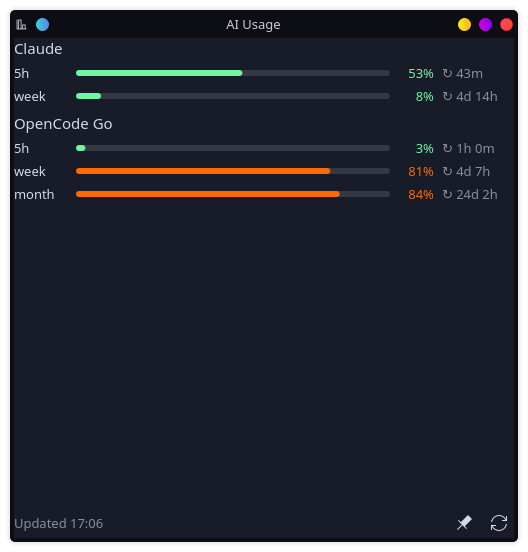

# plasma-ai-usage

Shows how much of your **Claude** and **OpenCode Go** subscription limits you've used, as a small Rust command and a KDE Plasma 6 panel widget.

<p align="center"></p>

In the panel it takes little space: one short label per provider, a thin bar for each limit, and the highest percentage. Click it to see every limit with its reset time.

- **Claude**: 5-hour session, weekly, weekly Opus (when your plan has one)
- **OpenCode Go**: 5-hour rolling, weekly, monthly
- Colours: green below 60 %, orange below 85 %, red from 85 %
- Each check is two small HTTPS requests. It uses **none of your AI quota**.
- Reuses the logins you already have (Claude Code, opencode). No extra sign-in.

## Requirements

- KDE Plasma 6 (`kpackagetool6`)
- Rust toolchain to build (`cargo`), e.g. `sudo pacman -S rust` on Arch/CachyOS
- At least one of:
  - [Claude Code](https://docs.claude.com/en/docs/claude-code), logged in with a Pro/Max subscription (`claude` → `/login`)
  - [opencode](https://opencode.ai), logged in to OpenCode Go (`opencode auth login`)

## Install

```sh
git clone https://github.com/overlordsvk/plasma-ai-usage.git
cd plasma-ai-usage
./install.sh
```

This builds the binary, installs it to `~/.local/bin/ai-usage` and installs the widget. Then right-click the panel → **Add Widgets…** → **AI Usage**.

Check it works from a terminal first:

```console
$ ai-usage
Claude
  5h    ███████████░░░░░░░░░  55%  resets in 38m
  week  ██░░░░░░░░░░░░░░░░░░   8%  resets in 4d 14h
OpenCode Go
  5h    █░░░░░░░░░░░░░░░░░░░   3%  resets in 55m
  week  ████████████████░░░░  81%  resets in 4d 7h
  month █████████████████░░░  84%  resets in 24d 2h
```

## Configuration

### Providers

With no config file, `ai-usage` shows every provider whose login it finds. To choose providers, rename them, change their order, hide limits or use other credentials, create a config file:

```sh
ai-usage --init        # writes ~/.config/ai-usage/config.toml
```

```toml
[[provider]]
type = "claude"
name = "Claude"
short = "C"               # label in the panel
windows = ["5h", "week"]  # optional: only these limits

[[provider]]
type = "opencode-go"
name = "OpenCode Go"
short = "OC"
```

| Key | Applies to | Meaning |
|---|---|---|
| `type` | all | `claude` or `opencode-go` (required) |
| `name`, `short` | all | Display name and panel label |
| `enabled` | all | `false` hides the provider |
| `windows` | all | Limits to show. Claude: `5h`, `week`, `opus`. OpenCode Go: `5h`, `week`, `month` |
| `credentials_file` | claude | Default `$CLAUDE_CONFIG_DIR/.credentials.json` or `~/.claude/.credentials.json` |
| `token_env` | claude | Read the OAuth access token from this environment variable instead |
| `auth_file`, `auth_entry` | opencode-go | Default `~/.local/share/opencode/auth.json`, entry `opencode-go` |
| `api_key_env` | opencode-go | Read the API key from this environment variable |
| `api_key` | opencode-go | API key written directly in the file (keep the file private) |

A type can appear more than once. For example, two Claude accounts with separate `credentials_file` paths each get their own row. See [`config.example.toml`](config.example.toml) for all options.

### Widget

Right-click the widget → **Configure AI Usage…**

- **Command**: what the widget runs. Default `$HOME/.local/bin/ai-usage --json`. Add `--config /path/to/file.toml` for a different config.
- **Update every**: 1–120 minutes (default 3).
- **Opacity**: for the bars and text.
- **Show widget background**: turn it off for a see-through look when the widget is on the desktop.
- **Keep open and on top**: the popup stays open above other windows. The pin button in the popup footer toggles the same setting.

## How it works

| Provider | Credentials (read-only) | Endpoint |
|---|---|---|
| Claude | Claude Code's OAuth token | `GET https://api.anthropic.com/api/oauth/usage` |
| OpenCode Go | opencode's API key | `GET https://opencode.ai/zen/go/v1/usage` |

The widget runs `ai-usage --json` on a timer and draws the result. Providers are fetched in parallel, and an error in one doesn't hide the others.

`ai-usage` **never refreshes the Claude token itself**. Refreshing would replace Claude Code's saved login and could log it out. When the token expires (after a few hours without using Claude Code), the widget shows *token expired*. Running `claude` once fixes it.

> **Note:** Neither endpoint is officially documented. Claude Code and opencode use them for their own usage screens, and they may change without notice. If a provider starts showing errors, please open an issue.

## Troubleshooting

| Symptom | Fix |
|---|---|
| Panel shows `AI ⚠` | Hover over it for the message. Usually the command path is wrong: run `ai-usage --json` in a terminal. |
| `token expired, run claude to refresh` | Run `claude` once. |
| `unauthorized` | Log in again (`claude` → `/login`, or `opencode auth login`). |
| Widget didn't change after updating | `systemctl --user restart plasma-plasmashell` |

## Uninstall

```sh
kpackagetool6 -t Plasma/Applet -r com.github.overlordsvk.plasma-ai-usage
rm ~/.local/bin/ai-usage
rm -r ~/.config/ai-usage
```

## License

[MIT](LICENSE). Not affiliated with Anthropic or OpenCode.
